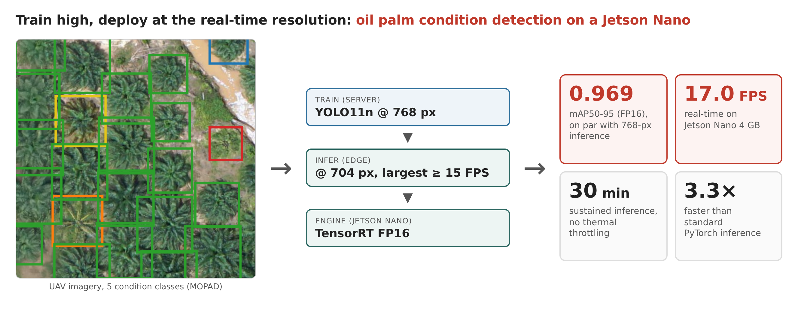

# tandan-edge

**Train high, deploy at the real-time resolution: oil palm condition detection with YOLO11n on a Jetson Nano.**

Code, configurations, per-run records and on-device measurements behind the
MethodsX article *[title — to be added on acceptance]*. Part of TANDAN
(Technology for Affordable Near-field Drone-based Assessment of oil palm plantations).



The method detects five oil palm conditions (dead, healthy, mismanaged,
smallish, yellowish) in UAV image tiles in real time on a Jetson Nano 4 GB:

1. screen lightweight detectors and modifications under one evaluation protocol (3 seeds, Welch t-test);
2. train the chosen detector (YOLO11n) at a resolution **higher** than the device can run in real time (768 px);
3. run it at the **largest resolution that still reaches the frame-rate target** on the device (704 px, ≥ 15 FPS);
4. deploy as a TensorRT FP16 engine and validate speed and temperature on the device.

| Configuration (MOPAD Site 2 val, 3 seeds) | mAP50-95 | Jetson Nano, TensorRT FP16 |
|---|---|---|
| YOLO11n, train 640 / run 640 | 0.9619 ± 0.0023 | 20.2 FPS |
| YOLO11n, train 704 / run 704 | 0.9648 ± 0.0003 | 17.0 FPS |
| YOLO11n, train 768 / run 768 | 0.9715 ± 0.0010 | 14.5 FPS (below target) |
| **YOLO11n, train 768 / run 704 (deployed)** | **0.9708 ± 0.0014** (FP32), **0.9685 ± 0.0029** (FP16) | **17.0 FPS**, stable for 30 min, GPU ≤ 36 °C |

Running the 768-px model at 704 px costs no significant accuracy (p ≈ 0.48 vs
running it at 768 px) and is significantly more accurate than training at 704 px
(p ≈ 0.014). TensorRT FP16 is ≈ 3.3× faster than PyTorch on the same board;
INT8 gives no speed-up on the Nano's Maxwell GPU.

---

## Repository layout

```
tandan-edge/
├── tandan_paths.py          every path the scripts use (override with TANDAN_DATA / TANDAN_RUNS)
├── data/mopad_site2.yaml    dataset definition (template)
├── model_configs/           YOLO11n base + every modified architecture that was screened
├── custom_modules/          layers/losses of the screened modifications (not used by the deployed model)
├── scripts/
│   ├── data/                MOPAD COCO -> YOLO conversion
│   ├── train/               training: base models, modifications, resolution study
│   ├── eval/                unified re-evaluation and the train x inference resolution matrix
│   ├── export/              ONNX export for TensorRT 8.2
│   └── paper/               rebuild every data table and figure from results/
├── jetson/                  TensorRT, PyTorch and thermal benchmarks on the Jetson Nano
├── results/                 the numbers reported in the paper (see "Where each number comes from")
├── weights/                 checkpoints (downloaded from the release, not in git)
└── docs/
```

## Environments

| | Training / evaluation | Edge device |
|---|---|---|
| Hardware | NVIDIA Quadro RTX 6000 24 GB | Jetson Nano 4 GB, MAXN (10 W) |
| Software | Python 3.8.10, PyTorch 2.0.1+cu117, Ultralytics 8.4.48 | JetPack 4.6.6 (L4T R32.7.6), CUDA 10.2, TensorRT 8.2.1; Python 3.8, PyTorch 1.11.0, Ultralytics 8.3.152 |
| Install | [`requirements.txt`](requirements.txt) | [`requirements-jetson.txt`](requirements-jetson.txt), [`jetson/README.md`](jetson/README.md) |

```bash
git clone https://github.com/<github-user>/tandan-edge.git
cd tandan-edge
python3 -m venv .venv && source .venv/bin/activate
pip install torch==2.0.1 torchvision==0.15.2 --index-url https://download.pytorch.org/whl/cu117
pip install -r requirements.txt
```

All commands below run from the repository root.

## Data

MOPAD (Zheng et al., 2021), **Site 2**, in YOLO format: 1,803 training and 500
validation tiles of 1024 × 1024 px; 118,740 training and 32,846 validation
boxes; class imbalance ≈ 384:1 (healthy vs dead). The dataset is not
redistributed here: download Site 2 from the official MOPAD repository,
<https://github.com/rs-dl/MOPAD> (COCO format: `train2017/`, `val2017/`,
`annotations/`), and convert it:

```bash
python scripts/data/coco_to_yolo.py --src /path/to/MOPAD_site2 --out datasets/mopad_site2
```

which gives

```
datasets/mopad_site2/
├── train/images/*.jpg   train/labels/*.txt
└── val/images/*.jpg     val/labels/*.txt
```

(or point `TANDAN_DATA` to another folder with that structure). Class ids:
0 dead, 1 healthy, 2 mismanaged, 3 smallish, 4 yellowish. The converter
prints image and box counts per split; compare them with the numbers above.

## Use the trained model

Download `tandan-edge_yolo11n_train768.pt` from the
[release](https://github.com/<github-user>/tandan-edge/releases) into `weights/`, then

```python
from ultralytics import YOLO
model = YOLO("weights/tandan-edge_yolo11n_train768.pt")
model.predict("tile.jpg", imgsz=704, conf=0.25, save=True)   # 704 px = deployed resolution
```

## Reproduce the paper

Training settings for every run: 150 epochs, early-stopping patience 50,
batch 16, optimizer `auto` (SGD, lr0 0.01), AMP, COCO-pretrained weights,
seeds 42, 123 and 456 where three seeds are reported. Each run writes to
`runs/<run_name>/`. Time estimates are for one Quadro RTX 6000.

**1. Base-model screening** (Table 4) — 12 runs, ~8–10 h
```bash
python scripts/train/train_base_models.py
```

**2. Modification screening** (Table 5)
```bash
python scripts/train/train_spd.py --exp A1                 # SPD-Conv, YOLO12n, 3 seeds
python scripts/train/train_vfl.py                          # Varifocal Loss, YOLO12n, 3 seeds
python scripts/train/train_rep.py                          # A2C2fRep, YOLO12n, 3 seeds
python scripts/train/train_cb_focal.py                     # class-balanced focal loss, YOLO11n, 3 seeds
python scripts/train/train_repc3k2.py                      # RepC3k2, YOLO11n, seed 42
python scripts/train/train_tandan.py --config model_configs/tandan-r1-scshead.yaml --name R1_scshead
python scripts/train/train_tandan.py --config model_configs/tandan-r2-simam.yaml   --name R2_simam
python scripts/train/train_tandan.py --config model_configs/tandan-r3-bifpn.yaml   --name R3_bifpn
python scripts/train/train_tandan.py --config model_configs/yolo11n-base.yaml --name R6_adamw768 --imgsz 768 --optimizer AdamW --lr0 0.001
```

**3. Resolution study** (Table 6, Fig. 4) — the 640-px models come from step 1
```bash
python scripts/train/train_tandan.py --config model_configs/yolo11n-base.yaml --name R5_res704 --imgsz 704 --seeds 42 123 456
python scripts/train/train_tandan.py --config model_configs/yolo11n-base.yaml --name R4_res768 --imgsz 768 --seeds 42 123 456
```
`R4_res768_seed42` is the deployed model.

**4. Unified re-evaluation** (all accuracy numbers)
```bash
python scripts/eval/reeval_all.py            # every run: best.pt, batch 16, conf 0.001, IoU 0.7, FP32
python scripts/eval/train_infer_matrix.py    # 3 training x 3 inference resolutions x FP32/FP16 x 3 seeds
```
Both overwrite the CSVs in `results/reeval/`, so `git diff results/` shows any
difference from the published values. The accuracy values that Ultralytics
logs during training (`results.csv`) are not used in the paper.

**5. Export and on-device benchmarks** (Tables 4, 7, 8; Figs. 5, 6) — see [`jetson/README.md`](jetson/README.md)
```bash
python scripts/export/export_onnx.py         # deploy/onnx/best_{640,704,768}.onnx (opset 12, static batch 1)
# then on the Jetson: jetson/benchmark_trt.sh, jetson/thermal_test.sh, jetson/bench_pytorch.py
```

**6. Tables and figures**
```bash
python scripts/paper/make_tables.py          # results/tables/T1–T8 (+ ALL_TABLES.md)
python scripts/paper/make_figures.py         # results/figures/
python scripts/paper/fig_dataset_samples.py  # Fig. 2b
```
Tables T1 and T3–T8 and figures F3–F6, S1, S2 need only `results/`; T2, F2a,
F2b need the dataset; F7 and F8 also need the deployed weights.

## Where each number comes from

| Paper item | File |
|---|---|
| Table 2 (dataset) | computed from the labels by `make_tables.py` → `results/tables/T2_dataset.csv` |
| Table 3 (settings) | `results/runs/R4_res768_seed42/args.yaml` |
| Tables 4, 5 (accuracy) | `results/reeval/reeval_runs.csv`, `reeval_summary.csv` |
| Tables 4, 5 (params, GFLOPs) | `results/runs/<run>/<run>_metrics.json` → `profile` |
| Table 4 (Jetson FPS) | `results/jetson/base_models_640/*_trt.log` |
| Table 6, Fig. 4 | `results/reeval/train_infer_runs.csv`, `train_infer_summary.csv` |
| Table 7, Fig. 5 | `results/jetson/trt_resolution/benchmark_summary.csv` (+ `logs/`), `results/jetson/pytorch_benchmark.csv` |
| Table 8, Fig. 6 | `results/jetson/thermal_30min/`, `results/jetson/thermal_5min/` |
| Fig. 7 | `results/reeval/cm_final_R4seed42_infer704.npy` (matrix[pred, gt], last index = background) |
| Confusion matrices of all runs | `results/reeval/cm/<run>.npy` |
| Training curves (Fig. S1) | `results/runs/<run>/results.csv` |

`results/runs/<run>/` keeps, for each of the 35 runs, the exact Ultralytics
arguments (`args.yaml`), the per-epoch log (`results.csv`) and the run summary
(`*_metrics.json`). `reeval_runs.csv` also lists rows that are not used in the
paper: four single-seed runs from an earlier pass (`exp01`–`exp04`), a
duplicate YOLO11n group (`T0_baseline`, identical to `yolo11n_seed*`), and an
invalid Network Slimming attempt (`T4a_sparsity`: its L1 penalty was attached
to a callback event that Ultralytics never fires, so the run reproduces
`yolo11n_seed42` exactly). Run paths in
the CSVs refer to the original workspace; `tandan_paths.P()` maps them to this
repository.

## Notes

- **Negative results are part of the method.** None of the screened
  architecture, loss or optimiser changes gave a significant,
  affordable gain over the plain detector (Table 5); the gain came from the
  training/inference resolution choice.
- `custom_modules/` are registered into Ultralytics at run time by the helpers
  in `scripts/train/` (no edits to the Ultralytics package). Checkpoints of the
  modified models reference `custom_modules.<name>`, so keep the folder name.
- Ultralytics 8.4.x is required for training (YOLO26n and the C2PSA/A2C2f
  blocks); the Jetson only needs 8.3.152 for the PyTorch benchmark.
- `train_cb_focal.py` uses the class counts that were used for the reported
  runs (dead = 231; the verified count is 234), kept for exact reproduction.

## Citation

If you use this code, please cite the article (see [`CITATION.cff`](CITATION.cff)) and the dataset:

> Zheng, J., Fu, H., Li, W., Wu, W., Yu, L., Yuan, S., ... & Kanniah, K. D. (2021).
> Growing status observation for oil palm trees using Unmanned Aerial Vehicle (UAV)
> images. *ISPRS Journal of Photogrammetry and Remote Sensing*, 173, 95–121.
> Dataset: <https://github.com/rs-dl/MOPAD>

## License

[AGPL-3.0](LICENSE), the license of the Ultralytics framework this code builds on.
The MOPAD dataset keeps its own terms.
